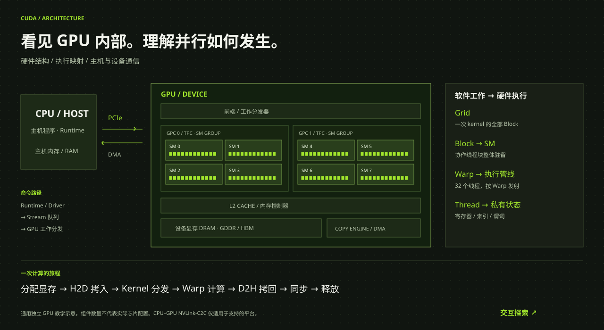
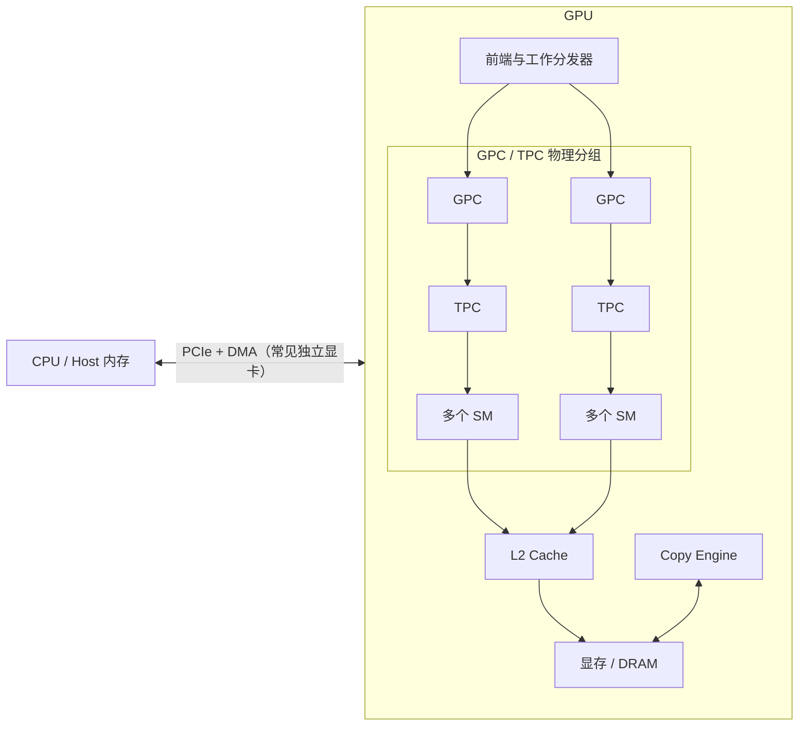
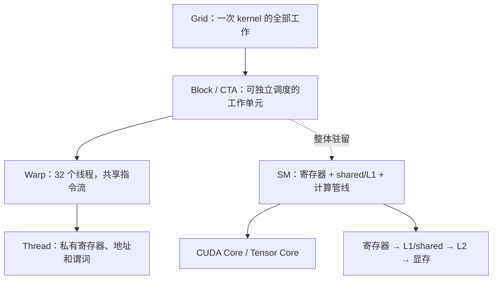
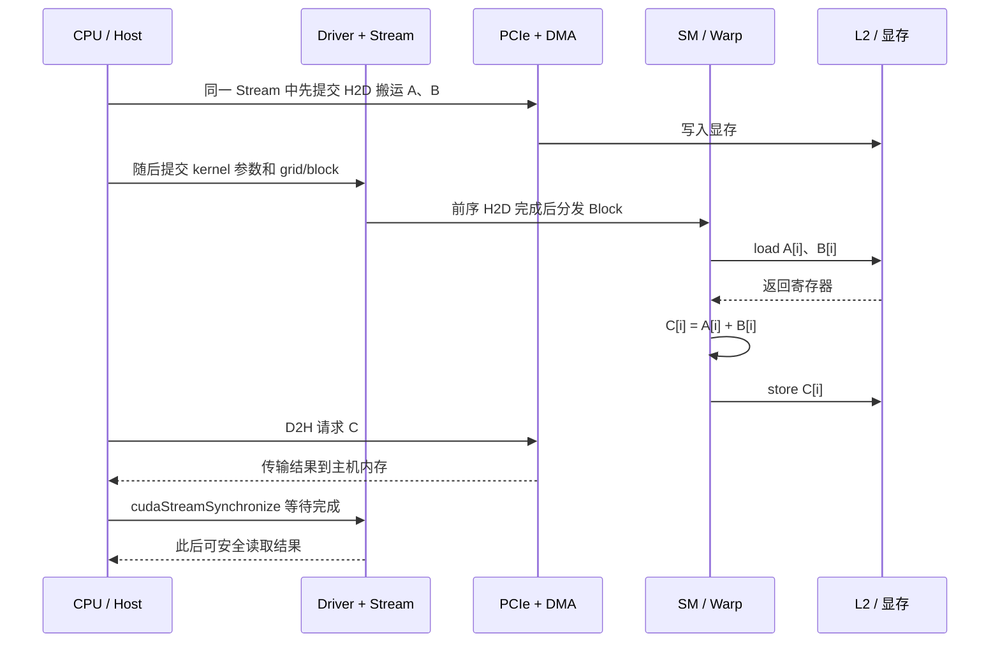

# CUDA 学习路线

> 基于 NVIDIA 官方《CUDA C++ Programming Guide》(598页) 和《CUDA C++ Best Practices Guide》(118页) 系统化设计
> 每天一个 CUDA 代码，不断熟悉，不断了解 GPU，学习并行异构计算与 GPU 编程

## GPU 架构交互首页

[](https://shaun-sheep111.github.io/cuda-learning-roadmap/)

**[打开 GPU 架构交互首页 →](https://shaun-sheep111.github.io/cuda-learning-roadmap/)**

黑绿芯片结构图支持点击查看 **CPU、工作分发器、SM、L2、显存与拷贝引擎**；切换视图理解 **Grid → Block → Warp → Thread** 如何映射到硬件，并逐步播放 **H2D → kernel → D2H → 同步** 的运行流程。支持手机浏览和键盘操作。

> 上图可在 GitHub 首页直接查看；点击进入 GitHub Pages 后使用交互功能。图中数量为教学示意，不代表特定 GPU 配置；本项目为独立学习项目，非 NVIDIA 官方网站。

## 📊 在线学习路线图

👉 **[点击查看完整学习路线图（在线渲染）](https://shaun-sheep111.github.io/cuda-learning-roadmap/roadmap.html)**

> 由 GitHub Pages 托管，可交互查看 60 天完整路线。

## 设计理念

本路线遵循 NVIDIA 官方推荐的 **APOD 方法论** (Assess → Parallelize → Optimize → Deploy)：

```
Assess (评估)     → 找到热点，分析瓶颈
Parallelize (并行化) → 用 CUDA 加速热点
Optimize (优化)    → 内存、指令、执行配置三层优化
Deploy (部署)     → 生产环境部署与兼容性
```

## 先看 GPU：结构、数据流和并行方式

CUDA 代码真正执行时，会经历“主机提交 → GPU 分发 → SM 执行 → 内存读写 → 结果回传”。先看下面三张图，再阅读 Day 01 的 kernel，会更容易理解 `gridDim`、`blockIdx`、`threadIdx` 和内存访问。

### 1. GPU 的整体结构



GPC/TPC 是 GPU 的物理组织方式；SM 是 CUDA 最重要的硬件执行单元。一个 SM 里有 warp scheduler、寄存器、shared memory/L1、CUDA Core、Tensor Core 和访存管线。

### 2. Grid、Block、Warp 如何落到 SM



对应到 CUDA：

```cpp
kernel<<<grid, block>>>(...);  // Grid 和 Block
int i = blockIdx.x * blockDim.x + threadIdx.x;  // 当前 Thread 找到数据
```

一个 Block 整体放到一个 SM 上，再拆成多个 Warp。Block 的执行顺序不能假设；Warp 内 32 个线程通常执行同一条指令，所以分支发散和非合并访存都会降低吞吐。

### 3. CPU-GPU 一次数据通信和计算



H2D/D2H 是 CPU 与 GPU 的通信，L2/显存是 GPU 内的数据路径，寄存器和 shared memory 是 SM 内的高速数据路径。动画版可以[打开 GPU Workflow Lab](https://shaun-sheep111.github.io/cuda-learning-roadmap/hardware_basics/gpu_workflow_animation.html)，用播放或单步观察这七个阶段。

如果想继续追踪“一个线程如何变成一次显存访问”，可以查看[从线程索引到显存地址的 3D 动画](https://shaun-sheep111.github.io/cuda-learning-roadmap/hardware_basics/memory_address_3d.html)，它展示 `blockIdx/blockDim/threadIdx → idx → base_addr + idx * sizeof(float) → L1/L2/VRAM`。

### 4. 并行计算方式速查

| 并行方式 | 如何拆分 | CUDA / AI Infra 例子 |
|---|---|---|
| 数据并行 | 每个线程处理一个元素或样本 | 向量加法、图像像素、Batch 推理 |
| 分块并行 | Block/Tile 搬入 shared，重复复用 | 矩阵乘、卷积、FlashAttention |
| 归约并行 | 多个局部结果合并为一个结果 | Sum、Max、Softmax、LayerNorm |
| 流水并行 | 让搬运、计算、写回阶段重叠 | 多 stream、异步拷贝、模型流水 |
| 多卡并行 | 切分 batch、张量、层或序列 | Data/Tensor/Pipeline/Sequence Parallel |

核心判断顺序是：**工作如何切分 → 数据在哪里 → 需要多少通信 → 同步范围多大 → 瓶颈是计算还是带宽**。这也是 FlashAttention、vLLM 和 CUDA kernel 共同使用的并行设计方法。

## GPU 硬件要点速览

> 详细讲解见 [`hardware_basics/`](hardware_basics/)。这里是首页自包含的核心要点。

**GPU vs CPU 的设计哲学**

| | CPU | GPU |
|---|---|---|
| 核心数 | 少（几个~几十） | 极多（数千 CUDA core） |
| 单核 | 强，低延迟，大缓存 | 弱，高吞吐 |
| 擅长 | 复杂逻辑、串行、分支 | 大规模数据并行 |

一句话：**CPU 优化延迟，GPU 优化吞吐**。GPU 靠"海量线程 + 快速切换"隐藏内存延迟。

**硬件组成**：`GPU → 多个 SM → CUDA Core / Tensor Core / 访存管线 + 调度器 + 寄存器 + 共享内存/L1`。Warp 和 Thread 是执行组织与线程状态，不是 Core 下一级的物理部件。
对应软件模型：`Grid → Block(落到一个 SM) → Warp → Thread`。

**Warp（最重要的概念）**：GPU 以 **32 个线程为一组(warp)** 执行同一条指令（SIMT）。由此两大性能点：
- **线程束分化**：warp 内走不同 if 分支 → 串行各分支 → 变慢。所以 block size 常取 32 的倍数。
- **合并访问**：warp 内线程访问连续且适当对齐的内存 → 用较少的内存事务完成 → 更高效；实际事务数量由访问宽度、对齐和架构决定。

**内存层次（快→慢 / 小→大）**

| 内存 | 速度 | 作用域 | 关键点 |
|---|---|---|---|
| 寄存器 | 最快 | 单线程 | 用超会 spill |
| 共享内存 | 很快 | Block 内 | 手动管理，注意 bank conflict |
| L1/L2 | 快 | SM/全局 | 硬件自动 |
| 全局内存(显存) | 慢(相对) | 所有线程 | 要合并访问 |

> 优化本质：**尽量把数据放在快的内存里、减少访问慢内存的次数**（分块 tiling、register tiling 的意义）。

## CUDA 基础语法速览

> 完整范式与可编译模板见 [`cuda_reference/`](cuda_reference/)。这里是首页自包含的最小速查。

**一次 CUDA 程序的 7 步骨架**

```
① cudaMalloc            分配显存
② cudaMemcpy H2D        拷入数据
③ kernel<<<grid,block>>>  启动核函数
④ cudaDeviceSynchronize / cudaEvent*   同步与计时
⑤ cudaMemcpy D2H        拷回结果
⑥ cudaFree              释放显存
⑦ cudaGetLastError      错误检查
```

**核函数与内置变量**

```cpp
__global__ void addKernel(const float *a, const float *b, float *c, int n) {
    int idx = blockIdx.x * blockDim.x + threadIdx.x;  // 当前线程负责第几个数据
    if (idx < n) c[idx] = a[idx] + b[idx];            // 边界检查
}
// 启动：block 取 32 的倍数，grid 向上取整
int block = 256, grid = (n + block - 1) / block;
addKernel<<<grid, block>>>(d_a, d_b, d_c, n);
```

| 限定符 | 执行位置 | 说明 |
|---|---|---|
| `__global__` | GPU | 核函数，`<<<>>>` 启动，返回 void |
| `__device__` | GPU | GPU 内部辅助函数 |
| `__shared__` | GPU | block 内共享的高速内存 |

内置变量：`threadIdx` / `blockIdx` / `blockDim` / `gridDim`。
同步：`__syncthreads()`（block 内屏障，共享内存读写之间用）。

**常用运行时 API**

| 类别 | 函数 |
|---|---|
| 内存 | `cudaMalloc` / `cudaMemcpy` / `cudaFree` / `cudaMallocHost`(pinned) |
| 拷贝方向 | `cudaMemcpyHostToDevice` / `DeviceToHost` / `DeviceToDevice` |
| 同步 | `cudaDeviceSynchronize` / `cudaStreamSynchronize` / `__syncthreads` |
| 计时 | `cudaEventCreate` → `cudaEventRecord` → `cudaEventSynchronize` → `cudaEventElapsedTime` → `cudaEventDestroy` |
| 错误 | `cudaGetLastError` / `cudaGetErrorString` |

**计时标准写法（测 GPU 真实耗时）**

```cpp
cudaEvent_t start, stop;
cudaEventCreate(&start); cudaEventCreate(&stop);
cudaEventRecord(start);
kernel<<<grid, block>>>(...);          // 要测的操作
cudaEventRecord(stop);
cudaEventSynchronize(stop);            // 等 GPU 真正算完
float ms; cudaEventElapsedTime(&ms, start, stop);
cudaEventDestroy(start); cudaEventDestroy(stop);
```

**三条路线**：手写 kernel（完全可控）｜ cuBLAS（官方成品库，注意列主序）｜ CUTLASS（可定制模板库）。三者只有"计算"那一步不同，内存/计时流程完全通用。详见 [`cuda_reference/`](cuda_reference/)。

## CUDA 之下的两层基础

CUDA 代码只是 GPU 编程接口。学习路线还需要回答两个更底层的问题：

1. **算法层**：如何把串行问题拆成独立任务，安排数据所有权，处理依赖、通信和同步？见 [`parallel_thinking/`](parallel_thinking/)。
2. **硬件层**：kernel 入队后，block 如何分发到 SM，warp 如何发射指令，数据如何经过 shared/L1/L2/显存和 PCIe/NVLink？见 [`hardware_basics/architecture_workflow.md`](hardware_basics/architecture_workflow.md)。

建议先完成这两个先修模块，再开始 Day 01；这样后续的 block、warp、shared memory、streams 和 profiling 都能对应到实际工作流程。

这套基础也适用于 AI Infra：FlashAttention 的 tile、online softmax 和数据复用，vLLM 的 continuous batching、PagedAttention 和 KV cache 分页，都是“重新组织工作、数据和通信”的并行设计问题。CUDA 是底层实现工具，先理解并行结构，才能读懂这些系统的设计取舍。

## 学习路线

先修：[并行计算思维](parallel_thinking/) · [GPU 硬件基础](hardware_basics/) · [编程范式速查](cuda_reference/)

阅读顺序：先修 → Week1-2 基础 → Week3-5 模式/实战 → Week6-9 优化/专家。
学 AI Infra 可从 `parallel_thinking/` 的 FlashAttention / vLLM 小节入手，再回到 Week3/4/7 找对应 kernel 与内存技术。

每周安排与每日内容统一在 [HTML 学习路线图](https://shaun-sheep111.github.io/cuda-learning-roadmap/roadmap.html) 中查看；下面补充面试准备与 AI Infra 实践方向。

## CUDA 面试题与答题要点

建议按“执行模型 → 内存与同步 → 性能分析 → 算子实现”的顺序准备。回答时给出适用条件、代码或性能数据，并说明如何验证正确性。

### 执行模型与内存

| 面试题 | 回答要点 / 追问 |
|---|---|
| 1. Grid、Block、Warp、Thread 与 SM 有什么关系？ | Grid 是一次 kernel 的全部 Block；传统 Block 调度中，一个 Block 驻留在单个 SM，一个 SM 可容纳多个 Block；Warp 由 32 个连续线性线程组成。线程不与 CUDA Core 永久绑定。 |
| 2. 为什么 block size 常取 32 的倍数？256 是否总是最优？ | 避免尾部不完整 Warp；最优配置还受寄存器、共享内存、Block 数和访存模式影响。用多组配置测量，不能只看线程数。 |
| 3. Warp divergence 为什么影响性能？ | 同 Warp 的不同路径通常需要分阶段执行，部分 lane 被屏蔽；影响取决于路径长度与分布。可讨论谓词化、任务重排及其代价。 |
| 4. Global、Shared、Register、L1/L2 的区别？ | 区分作用域、生命周期、显式管理与硬件缓存；寄存器压力可能造成 spill，local memory 虽为线程私有，却位于设备内存体系。 |
| 5. 什么是合并访存？连续访问一定只有一次事务吗？ | Warp 的地址、对齐、访问宽度和架构决定事务数；连续且对齐通常可减少事务。解释 stride、AoS/SoA 与矩阵转置的差别。 |
| 6. Shared Memory 的 bank conflict 是什么？ | 同一 Warp 的访问映射到相同 bank 的不同地址时可能发生冲突；同地址广播是重要例外。以矩阵转置和 padding 解释，注意数据类型与架构差异。 |
| 7. `__syncthreads()`、`__syncwarp()` 和原子操作分别解决什么？ | 前两者分别同步 Block / 指定 Warp 成员，并提供相应内存顺序保证；原子操作保证目标操作的原子性，不能充当整个 Block 的屏障。普通 kernel 的 Block 间没有通用全局屏障。 |
| 8. 尾部不足 32 个元素时，如何安全做 Warp 归约？ | 完整 Warp 共同执行，越界数据填归约单位元；mask 中尚未退出的成员须执行同次操作。稀疏 mask 不会压紧 lane 编号，也不能保证 shuffle 源 lane 有效。 |

### 异步执行与性能优化

| 面试题 | 回答要点 / 追问 |
|---|---|
| 9. Kernel 启动返回后，GPU 是否已经完成计算？ | 通常没有；区分启动错误与异步执行错误。分别检查 `cudaGetLastError()` 与适当的同步调用，避免逐 kernel 全局同步破坏并发。 |
| 10. 多 Stream 就能让传输与计算重叠吗？ | 还需设备并发能力、适当的 pinned 主机内存、异步 API 与独立任务；同 Stream 依序执行，跨 Stream 用 Event 建立依赖，并留意默认 Stream 语义。 |
| 11. 为什么 Occupancy 高不一定快？ | Occupancy 是活跃 Warp 数相对硬件上限的比例。更高占用率可能牺牲寄存器复用；低占用率也可能已饱和算术或带宽。结合 stall、吞吐和执行时间判断。 |
| 12. 如何区分计算瓶颈、显存瓶颈和启动开销？ | 用 Roofline 比较算术强度与带宽 / 算力上限，再用 Nsight 验证；短 kernel 还可能受启动与调度开销限制。避免仅依据 GPU 利用率下结论。 |
| 13. 如何可靠地测量 kernel 性能？ | 预热，隔离 JIT / 分配等一次性开销，在正确 Stream 上用 CUDA Event，多次重复并报告分布；分别测设备耗时和端到端延迟，校验输出误差。 |
| 14. GEMM 为什么需要 Shared / Register Tiling？ | 增加数据复用、提高算术强度；分析 tile 大小、寄存器压力、边界、流水与 Tensor Core 数据布局之间的取舍，并与 cuBLAS 对比。 |
| 15. CUDA Graph 和算子融合有什么区别？ | Graph 降低重复提交一组工作的 CPU 开销；融合可减少 kernel 启动及中间张量读写，但也可能增加资源压力。Graph 本身不等于算子融合。 |
| 16. 如何排查 kernel 结果偶发错误？ | 检查越界、未初始化、数据竞争、同步参与条件、跨 Stream 生命周期和数值误差；用 Compute Sanitizer 的 memcheck / racecheck 等工具缩小问题范围。 |

### 手写与性能分析练习

| 练习题 | 必须解释的边界与验证方式 | 仓库入口 |
|---|---|---|
| 实现任意长度 Sum / Max 归约 | 非 2 的幂、尾部 mask、跨 Block 合并、浮点误差；与 CPU 结果对比 | [归约优化](week3_patterns/day15_reduction.cu)、[Warp Shuffle](week4_advanced/day23_warp_shuffle.cu) |
| 实现高效矩阵转置 | 合并读写、Shared Memory padding、非整 tile 边界；报告有效带宽 | [矩阵转置](week2_memory/day09_matrix_transpose.cu) |
| 从朴素 GEMM 优化到分块 GEMM | 数据复用、寄存器 / Shared 资源占用；说明不同矩阵形状的表现 | [分块 GEMM](week3_patterns/day17_tiled_matmul.cu)、[SGEMM 优化链](hardware_basics/sgemm_optimize.md) |
| 设计分块 H2D → 计算 → D2H 流水 | Stream 依赖、缓冲区复用与主机读取时机；用时间线证明重叠 | [Stream 与 Event](week4_advanced/day25_streams_events.cu) |

语法查阅：[CUDA 编程范式与 Warp API](cuda_reference/README.md)。硬件与分析基础：[GPU 工作流程](hardware_basics/architecture_workflow.md)、[并行计算思维](parallel_thinking/README.md)。

## AI Infra：从 CUDA 算子到训练与推理系统

AI Infra 需要同时理解 **算子执行、显存管理、请求调度与多卡通信**。单个 kernel 变快只是其中一环；应围绕真实负载、正确性、端到端延迟和资源成本选择优化方法。

### 核心方向与面试追问

| 方向 | 需要掌握的内容 | 典型面试题 / 分析任务 |
|---|---|---|
| 算子与编译 | GEMM、Reduction、Softmax、LayerNorm / RMSNorm；融合、布局、CUDA / Triton、框架算子调用 | 为什么融合可能更慢？如何判断应使用 cuBLAS、编译器生成代码还是手写 kernel？ |
| Attention 与 FlashAttention | Q/K/V、分块、online softmax、片上复用；减少 Attention 中间矩阵的显存读写 | 不显式保存完整注意力矩阵，如何保持 softmax 数值稳定？标准精确 Attention 的计算复杂度是否改变？ |
| LLM 推理阶段 | Prefill 一次处理输入序列，Decode 逐步生成；batch、序列长度、GQA / MQA 对工作负载的影响 | 为什么两阶段瓶颈常不同？Prefill 常更易利用矩阵计算，Decode 小 batch 常受权重 / KV 访存影响，但如何验证？ |
| KV Cache 与 PagedAttention | KV 容量、逻辑块到物理块映射、碎片、前缀共享与引用生命周期 | PagedAttention 如何改善分配与利用率？为什么它不自动减少每个 token 原始 KV 数据量？ |
| 推理服务与调度 | Continuous Batching、Chunked Prefill、请求准入、抢占、取消与背压 | 长输入怎样影响短请求？吞吐增加时 TTFT、TPOT 与 P99 如何变化？ |
| 分布式训练 | DDP、梯度 All-Reduce、梯度累积、混合精度、ZeRO / FSDP 状态分片 | 参数、梯度、优化器状态与激活分别占多少显存？分片如何以通信换容量？ |
| 多卡推理与通信 | DP / TP / PP / EP；All-Reduce、All-Gather、Reduce-Scatter、All-to-All；NCCL 与拓扑 | TP 的通信为什么可能限制低延迟？EP 的 All-to-All 与负载不均如何影响 MoE？ |
| 量化与部署 | FP16 / BF16、INT8 / INT4、权重量化与 KV 量化、scale、反量化及可用 kernel | 为什么模型更小不一定更快？如何同时验证精度、延迟、显存与硬件支持？ |
| 性能与稳定性 | Nsight Systems / Compute、框架 profiler、显存峰值、OOM、服务监控与压测 | GPU 利用率高但吞吐低，如何区分计算、访存、通信、CPU 调度和排队问题？ |

### 两个必须会估算的问题

**1. KV Cache 大约占多少显存？**

对常见 decoder-only 模型，若每层 KV 结构相同、K/V 使用相同存储精度，已缓存 token 的原始 KV 大小可估为：

```text
KV bytes ≈ 2 × L × Σ(T_i) × H_kv × D_head × S

2       ：Key 与 Value
L       ：层数
Σ(T_i)  ：各请求当前已缓存 token 数之和
H_kv    ：KV head 数（GQA / MQA 中通常小于 Query head 数）
D_head  ：每个 head 的维度
S       ：每元素存储字节数，例如 FP16 / BF16 为 2
```

例如 32 层、8 个 KV heads、head dim 为 128、FP16 存储，一个请求缓存 4096 tokens，原始 KV 约为 **512 MiB**。实际分配还需考虑页块对齐、元数据、量化 scale 与并行切分；前缀共享可减少重复存储。模型权重、激活和工作区另算。

**2. 为什么 batch 变大可能提高吞吐，却让用户感觉更慢？**

更大 batch 可摊薄权重读取与启动开销，也会增加工作量、显存压力及等待时间。必须联合观察：

| 指标 | 含义 | 分析时的注意点 |
|---|---|---|
| TTFT | 请求到达至第一个 token 的时间 | 明确是否包含排队、分词、Prefill 与网络 |
| TPOT / ITL | 输出 token 的平均间隔 / 相邻 token 延迟 | 区分均值与逐 token 分布；说明统计口径 |
| Throughput | 每秒请求数或 token 数 | 明确输入 / 输出 token、并发、长度分布与硬件 |
| P50 / P95 / P99 | 延迟分位数 | 关注长尾，并说明样本量和压测方式 |
| Goodput | 满足指定延迟与质量目标的有效吞吐 | 先定义 SLO，再比较优化收益 |

### 建议完成的 AI Infra 实践

1. **算子优化报告**：实现稳定 Softmax 或 RMSNorm，对比框架基线，覆盖不同形状与精度；提交误差、带宽 / 耗时、性能分析与适用边界。
2. **Attention 数据流分析**：画出朴素 Attention 与分块 Attention 的中间结果去向，推导 online softmax 的最大值、归一化和输出累积更新，解释减少了哪些显存读写。
3. **推理服务压测**：使用固定模型与硬件，对比输入 / 输出长度、并发和 batching 配置；记录 TTFT、TPOT、吞吐、P99 与峰值显存，给出满足 SLO 的配置。
4. **多卡通信实验**：在可用的多卡环境测量不同消息大小的集合通信，结合 GPU / 网络拓扑解释延迟与带宽，并分析 TP、DP 或 EP 的通信需求。

这些是扩展实践方向，仓库中的 CUDA 练习提供底层基础；训练 / 推理服务实验需要另外配置模型、框架与硬件环境。

继续阅读：[并行思维中的 FlashAttention / vLLM 分析](parallel_thinking/README.md) · [vLLM 文档](https://docs.vllm.ai/) · [PyTorch 分布式文档](https://docs.pytorch.org/docs/stable/distributed.html) · [NCCL 文档](https://docs.nvidia.com/deeplearning/nccl/user-guide/docs/) · [Triton 教程](https://triton-lang.org/main/getting-started/tutorials/index.html)。

---

## 环境要求

本仓库代码在以下环境开发并测试通过：

| 项目 | 版本 / 型号 |
|------|-------------|
| GPU | NVIDIA RTX 4090 (Ada Lovelace, **sm_89**) |
| NVIDIA 驱动 | 590.48.01 |
| CUDA Toolkit | 13.0 (`nvcc` 编译器) |
| 驱动支持的最高 CUDA | 13.1 (`nvidia-smi` 显示) |

> **说明**：`nvidia-smi` 显示的 `CUDA Version: 13.1` 是**驱动能支持的最高版本**，
> 而 `nvcc --version` 显示的 `13.0` 是实际安装的 **Toolkit 版本**。
> 两者只要满足 `nvcc 版本 ≤ 驱动支持版本` 即可正常编译运行。

查看你自己的环境：

```bash
nvidia-smi        # 看 GPU 型号、驱动版本、支持的最高 CUDA 版本
nvcc --version    # 看已安装的 CUDA Toolkit 版本
```

> **换其他显卡**：代码默认按 RTX 4090 的 `-arch=sm_89` 编译。
> 若使用其他 NVIDIA 显卡，需修改 `Makefile` 中的 `-arch=sm_89` / `compute_89` 为对应架构
> （如 RTX 3090 → `sm_86`，A100 → `sm_80`）。可用 `nvidia-smi --query-gpu=compute_cap --format=csv` 查询你的计算能力。

---

## 环境配置 (RTX 4090 服务器)

```bash
# 1. 传到服务器
scp -r cuda-learning-roadmap/ user@server:~/

# 2. SSH 登录，运行环境检查
ssh user@server
cd cuda-learning-roadmap && bash setup.sh

# 3. 开始学习
make run01    # Day 01: Hello CUDA
make run40    # Day 40: Tensor Cores
make run60    # Day 60: 毕业项目
```

### RTX 4090 关键参数

| 参数 | 值 | 编程影响 |
|------|-----|---------|
| 架构 | Ada Lovelace (sm_89) | Makefile 已配置 -arch=sm_89 |
| SM 数量 | 128 | 理论最大 128×2048 = 262144 线程 |
| 显存 | 24 GB GDDR6X | 大数据集无需分块 |
| 显存带宽 | 1008 GB/s | 优化目标: 有效带宽 > 600 GB/s |
| 共享内存/SM | 100 KB | Tile size 可更大 |
| L2 缓存 | 72 MB | 大缓存利于数据复用 |
| Tensor Cores | 第 4 代 | 支持 FP16/BF16/INT8/FP8 |

### 编译运行

```bash
make          # 编译全部 60 天
make run01    # 编译并运行 Day 01
make run60    # 编译并运行 Day 60
make run-all  # 运行全部
make clean    # 清理
make help     # 帮助
```

---

## 学习建议

### 每日学习流程 (1-2 小时)

```
1. 阅读当天代码文件头部的「学习目标」和「核心概念」(10 分钟)
2. 阅读对应的官方指南章节 (15-20 分钟)
3. 编译运行代码，观察输出 (10 分钟)
4. 修改代码参数/尝试扩展练习 (30-40 分钟)
5. 用 Nsight 分析性能 (10 分钟)
6. 记录学习笔记 (5 分钟)
```

### 阶段性目标

| 阶段 | 天数 | 目标 | 验证标准 |
|------|------|------|---------|
| 入门 | Day 1-14 | 理解 CUDA 编程模型和内存层次 | 能独立写出向量加法、矩阵转置 |
| 进阶 | Day 15-30 | 掌握并行模式和 warp 编程 | 能实现归约、scan、排序 |
| 高级 | Day 31-37 | 掌握性能分析和优化方法论 | 能用 APOD 优化一个 kernel |
| 专家 | Day 38-52 | 掌握 Tensor Cores、Graph、异步 | 能用 WMMA 写矩阵乘法 |
| 大师 | Day 53-60 | 综合实战能力 | 能独立完成图像处理管线 |

### 性能基准记录表

建议每天记录 kernel 的关键性能指标：

| 指标 | 含义 | 4090 目标 |
|------|------|----------|
| 执行时间 (ms) | kernel 运行时间 | 越低越好 |
| 有效带宽 (GB/s) | 实际带宽利用率 | > 600 (60% 峰值) |
| Occupancy (%) | SM 占用率 | > 75% |
| 计算强度 (FLOP/Byte) | 算术/内存比 | 越高越偏计算密集 |

---

## 推荐资源

1. **CUDA C++ Programming Guide** — 本路线的核心参考 (已提供 PDF)
2. **CUDA C++ Best Practices Guide** — 性能优化圣经 (已提供 PDF)
3. **Nsight Systems** — 宏观时间线分析 (`nsys profile`)
4. **Nsight Compute** — 微观 kernel 分析 (`ncu --set full`)
5. **CUDA Samples** — NVIDIA 官方示例代码
6. **Programming Massively Parallel Processors** — 教科书 (PMPP)

---

## 学完之后

- 掌握 CUDA 编程从基础到专家的完整知识体系
- 能独立开发、优化和部署高性能 GPU 程序
- 理解 GPU 架构（SIMT、内存层次、Tensor Cores）
- 熟练使用 APOD 方法论进行性能优化
- 为深度学习 GPU 编程（CUDA Kernel 开发、推理引擎优化）打下坚实基础

---

> *每日一个* *CUDA* *程序，从* *GPU* *硬件结构练到* *kernel*优化，最终服务于模型推理部署加速。
