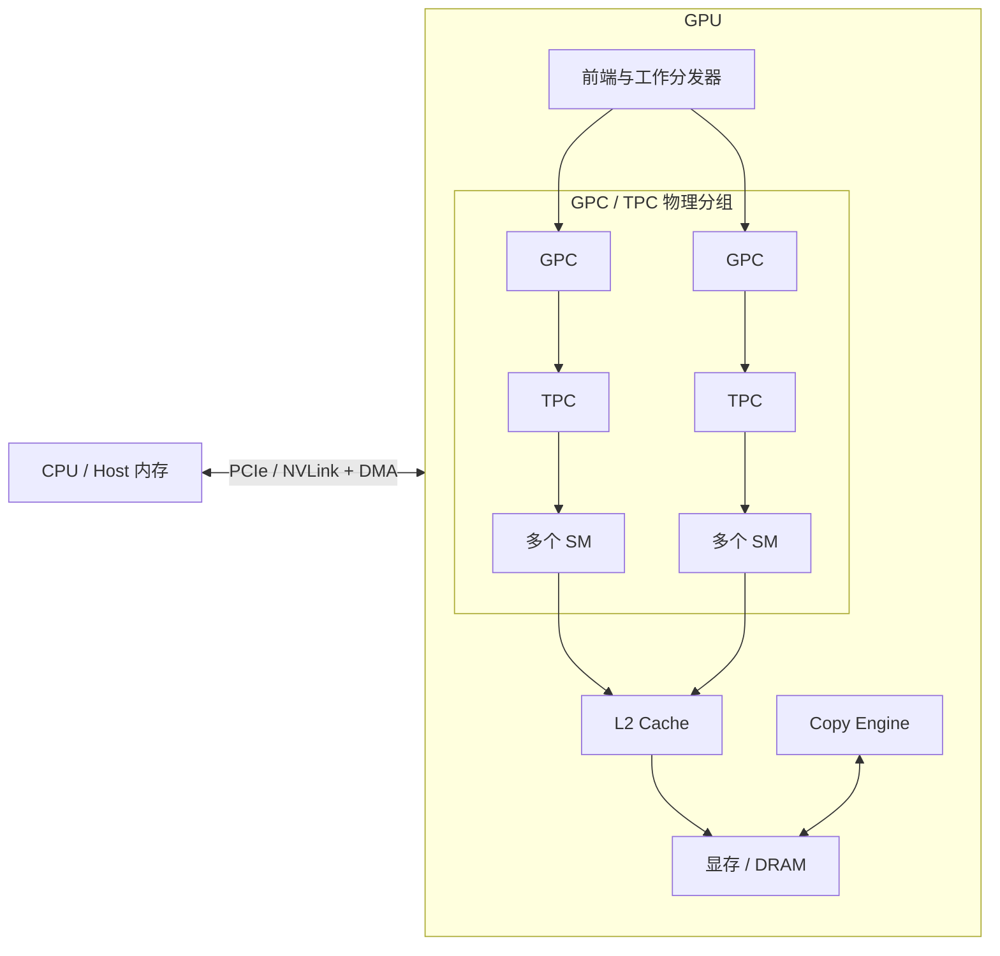
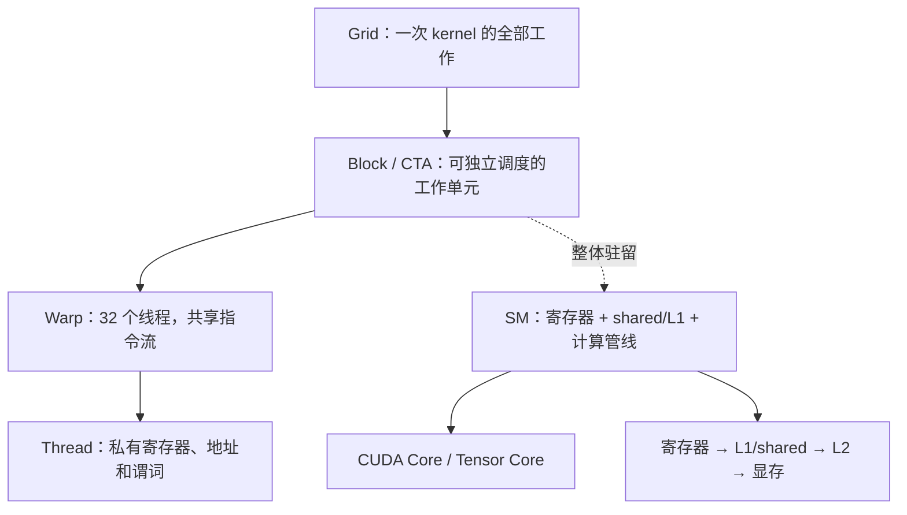
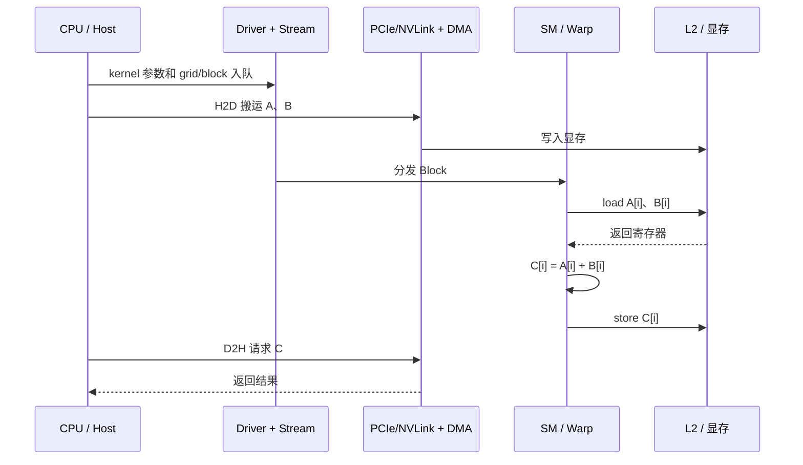

# CUDA 学习路线

> 基于 NVIDIA 官方《CUDA C++ Programming Guide》(598页) 和《CUDA C++ Best Practices Guide》(118页) 系统化设计
> 每天一个 CUDA 代码，不断熟悉，不断了解 GPU，学习并行异构计算与 GPU 编程

## 📊 在线学习路线图

👉 **[点击查看完整学习路线图（在线渲染）](https://shaun-sheep111.github.io/cuda-learning-roadmap/roadmap.html)**

> 由 GitHub Pages 托管，可交互查看 60 天完整路线。

## 设计理念

本路线遵循 NVIDIA 官方推荐的 **APOD 方法论** (Assess → Parallelize → Optimize → Deploy)：

```
Assess (评估)     → 找到热点，分析瓶颈
Parallelize (并行化) → 用 CUDA 加速热点
Optimize (优化)    → 内存、指令、执行配置三层优化
Deploy (部署)     → 生产环境部署与兼容性
```

## 先看 GPU：结构、数据流和并行方式

CUDA 代码真正执行时，会经历“主机提交 → GPU 分发 → SM 执行 → 内存读写 → 结果回传”。先看下面三张图，再阅读 Day 01 的 kernel，会更容易理解 `gridDim`、`blockIdx`、`threadIdx` 和内存访问。

### 1. GPU 的整体结构



GPC/TPC 是 GPU 的物理组织方式；SM 是 CUDA 最重要的硬件执行单元。一个 SM 里有 warp scheduler、寄存器、shared memory/L1、CUDA Core、Tensor Core 和访存管线。

### 2. Grid、Block、Warp 如何落到 SM



对应到 CUDA：

```cpp
kernel<<<grid, block>>>(...);  // Grid 和 Block
int i = blockIdx.x * blockDim.x + threadIdx.x;  // 当前 Thread 找到数据
```

一个 Block 整体放到一个 SM 上，再拆成多个 Warp。Block 的执行顺序不能假设；Warp 内 32 个线程通常执行同一条指令，所以分支发散和非合并访存都会降低吞吐。

### 3. CPU-GPU 一次数据通信和计算



H2D/D2H 是 CPU 与 GPU 的通信，L2/显存是 GPU 内的数据路径，寄存器和 shared memory 是 SM 内的高速数据路径。动画版可以[打开 GPU Workflow Lab](https://shaun-sheep111.github.io/cuda-learning-roadmap/hardware_basics/gpu_workflow_animation.html)，用播放或单步观察这七个阶段。

如果想继续追踪“一个线程如何变成一次显存访问”，可以查看[从线程索引到显存地址的 3D 动画](https://shaun-sheep111.github.io/cuda-learning-roadmap/hardware_basics/memory_address_3d.html)，它展示 `blockIdx/blockDim/threadIdx → idx → base_addr + idx * sizeof(float) → L1/L2/VRAM`。

### 4. 并行计算方式速查

| 并行方式 | 如何拆分 | CUDA / AI Infra 例子 |
|---|---|---|
| 数据并行 | 每个线程处理一个元素或样本 | 向量加法、图像像素、Batch 推理 |
| 分块并行 | Block/Tile 搬入 shared，重复复用 | 矩阵乘、卷积、FlashAttention |
| 归约并行 | 多个局部结果合并为一个结果 | Sum、Max、Softmax、LayerNorm |
| 流水并行 | 让搬运、计算、写回阶段重叠 | 多 stream、异步拷贝、模型流水 |
| 多卡并行 | 切分 batch、张量、层或序列 | Data/Tensor/Pipeline/Sequence Parallel |

核心判断顺序是：**工作如何切分 → 数据在哪里 → 需要多少通信 → 同步范围多大 → 瓶颈是计算还是带宽**。这也是 FlashAttention、vLLM 和 CUDA kernel 共同使用的并行设计方法。

## GPU 硬件要点速览

> 详细讲解见 [`hardware_basics/`](hardware_basics/)。这里是首页自包含的核心要点。

**GPU vs CPU 的设计哲学**

| | CPU | GPU |
|---|---|---|
| 核心数 | 少（几个~几十） | 极多（数千 CUDA core） |
| 单核 | 强，低延迟，大缓存 | 弱，高吞吐 |
| 擅长 | 复杂逻辑、串行、分支 | 大规模数据并行 |

一句话：**CPU 优化延迟，GPU 优化吞吐**。GPU 靠"海量线程 + 快速切换"隐藏内存延迟。

**硬件层次**：`GPU → 多个 SM → (CUDA Core + Tensor Core + 寄存器 + 共享内存/L1) → Warp(32线程) → Thread`
对应软件模型：`Grid → Block(落到一个 SM) → Warp → Thread`。

**Warp（最重要的概念）**：GPU 以 **32 个线程为一组(warp)** 执行同一条指令（SIMT）。由此两大性能点：
- **线程束分化**：warp 内走不同 if 分支 → 串行各分支 → 变慢。所以 block size 常取 32 的倍数。
- **合并访问**：warp 内 32 线程访问连续内存 → 合并为一次事务 → 快；访问分散则慢。

**内存层次（快→慢 / 小→大）**

| 内存 | 速度 | 作用域 | 关键点 |
|---|---|---|---|
| 寄存器 | 最快 | 单线程 | 用超会 spill |
| 共享内存 | 很快 | Block 内 | 手动管理，注意 bank conflict |
| L1/L2 | 快 | SM/全局 | 硬件自动 |
| 全局内存(显存) | 慢(相对) | 所有线程 | 要合并访问 |

> 优化本质：**尽量把数据放在快的内存里、减少访问慢内存的次数**（分块 tiling、register tiling 的意义）。

## CUDA 基础语法速览

> 完整范式与可编译模板见 [`cuda_reference/`](cuda_reference/)。这里是首页自包含的最小速查。

**一次 CUDA 程序的 7 步骨架**

```
① cudaMalloc            分配显存
② cudaMemcpy H2D        拷入数据
③ kernel<<<grid,block>>>  启动核函数
④ cudaDeviceSynchronize / cudaEvent*   同步与计时
⑤ cudaMemcpy D2H        拷回结果
⑥ cudaFree              释放显存
⑦ cudaGetLastError      错误检查
```

**核函数与内置变量**

```cpp
__global__ void addKernel(const float *a, const float *b, float *c, int n) {
    int idx = blockIdx.x * blockDim.x + threadIdx.x;  // 当前线程负责第几个数据
    if (idx < n) c[idx] = a[idx] + b[idx];            // 边界检查
}
// 启动：block 取 32 的倍数，grid 向上取整
int block = 256, grid = (n + block - 1) / block;
addKernel<<<grid, block>>>(d_a, d_b, d_c, n);
```

| 限定符 | 执行位置 | 说明 |
|---|---|---|
| `__global__` | GPU | 核函数，`<<<>>>` 启动，返回 void |
| `__device__` | GPU | GPU 内部辅助函数 |
| `__shared__` | GPU | block 内共享的高速内存 |

内置变量：`threadIdx` / `blockIdx` / `blockDim` / `gridDim`。
同步：`__syncthreads()`（block 内屏障，共享内存读写之间用）。

**常用运行时 API**

| 类别 | 函数 |
|---|---|
| 内存 | `cudaMalloc` / `cudaMemcpy` / `cudaFree` / `cudaMallocHost`(pinned) |
| 拷贝方向 | `cudaMemcpyHostToDevice` / `DeviceToHost` / `DeviceToDevice` |
| 同步 | `cudaDeviceSynchronize` / `cudaStreamSynchronize` / `__syncthreads` |
| 计时 | `cudaEventCreate` → `cudaEventRecord` → `cudaEventSynchronize` → `cudaEventElapsedTime` → `cudaEventDestroy` |
| 错误 | `cudaGetLastError` / `cudaGetErrorString` |

**计时标准写法（测 GPU 真实耗时）**

```cpp
cudaEvent_t start, stop;
cudaEventCreate(&start); cudaEventCreate(&stop);
cudaEventRecord(start);
kernel<<<grid, block>>>(...);          // 要测的操作
cudaEventRecord(stop);
cudaEventSynchronize(stop);            // 等 GPU 真正算完
float ms; cudaEventElapsedTime(&ms, start, stop);
cudaEventDestroy(start); cudaEventDestroy(stop);
```

**三条路线**：手写 kernel（完全可控）｜ cuBLAS（官方成品库，注意列主序）｜ CUTLASS（可定制模板库）。三者只有"计算"那一步不同，内存/计时流程完全通用。详见 [`cuda_reference/`](cuda_reference/)。

## CUDA 之下的两层基础

CUDA 代码只是 GPU 编程接口。学习路线还需要回答两个更底层的问题：

1. **算法层**：如何把串行问题拆成独立任务，安排数据所有权，处理依赖、通信和同步？见 [`parallel_thinking/`](parallel_thinking/)。
2. **硬件层**：kernel 入队后，block 如何分发到 SM，warp 如何发射指令，数据如何经过 shared/L1/L2/显存和 PCIe/NVLink？见 [`hardware_basics/architecture_workflow.md`](hardware_basics/architecture_workflow.md)。

建议先完成这两个先修模块，再开始 Day 01；这样后续的 block、warp、shared memory、streams 和 profiling 都能对应到实际工作流程。

这套基础也适用于 AI Infra：FlashAttention 的 tile、online softmax 和数据复用，vLLM 的 continuous batching、PagedAttention 和 KV cache 分页，都是“重新组织工作、数据和通信”的并行设计问题。CUDA 是底层实现工具，先理解并行结构，才能读懂这些系统的设计取舍。

## 学习路线

先修：[并行计算思维](parallel_thinking/) · [GPU 硬件基础](hardware_basics/) · [编程范式速查](cuda_reference/)

阅读顺序：先修 → Week1-2 基础 → Week3-5 模式/实战 → Week6-9 优化/专家。
学 AI Infra 可从 `parallel_thinking/` 的 FlashAttention / vLLM 小节入手，再回到 Week3/4/7 找对应 kernel 与内存技术。

具体每周内容见下方总览表：

## 路线总览

<details open>
<summary>展开 / 收起 9 周总览表</summary>

| 阶段 | 周次 | 天数 | 主题 | 难度 | 官方指南对应 |
|------|------|------|------|------|-------------|
| **先修** | 并行计算思维 | — | 任务拆分 / 依赖 / 通信 / 同步 / Roofline | ★☆☆☆☆ | [`parallel_thinking/`](parallel_thinking/) |
| **先修** | 硬件基础 | — | GPU 工作流程 / SM / warp / 内存层次 | ★☆☆☆☆ | [`hardware_basics/`](hardware_basics/) |
| **入门** | Week 1 | Day 01-07 | CUDA 基础概念 | ★☆☆☆☆ | PG Ch3-5, BPG Ch2-3 |
| **入门** | Week 2 | Day 08-14 | 内存模型入门 | ★★☆☆☆ | PG Ch6.2, BPG Ch10 |
| **进阶** | Week 3 | Day 15-21 | 并行模式 | ★★☆☆☆ | PG Ch10, BPG Ch12 |
| **进阶** | Week 4 | Day 22-28 | 高级主题 | ★★★☆☆ | PG Ch10-11 |
| **进阶** | Week 5 | Day 29-30 | 实战项目 | ★★★☆☆ | 综合 |
| **高级** | Week 6 | Day 31-37 | 性能优化与 APOD | ★★★☆☆ | BPG Ch8-13, PG Ch8 |
| **专家** | Week 7 | Day 38-44 | 高级并行编程 | ★★★★☆ | PG Ch10.19-10.28, Ch12, Ch20 |
| **专家** | Week 8 | Day 45-52 | CUDA 生态系统 | ★★★★☆ | PG Ch13-16, BPG Ch6,14-20 |
| **大师** | Week 9 | Day 53-60 | 专家级实战 | ★★★★★ | 全部综合 |

> **PG** = Programming Guide, **BPG** = Best Practices Guide

</details>

---

## 每日详细路线

<details>
<summary>展开查看 Week 1–9 每日代码与知识点（60 天）</summary>

### Week 1: CUDA 基础 (Day 01-07) — 入门

| Day | 文件 | 主题 | 官方指南映射 | 学到什么 |
|-----|------|------|-------------|----------|
| 01 | `day01_hello_cuda.cu` | Hello CUDA | PG 3-5.1 | Kernel 编写, grid/block/thread, H2D/D2H 传输 |
| 02 | `day02_device_query.cu` | 设备查询 | PG 5.6, BPG 15 | GPU 硬件参数, 计算能力, 配置选择 |
| 03 | `day03_vector_ops.cu` | 向量运算 | PG 5.2 | Grid/Block 配置对比, grid-stride loop |
| 04 | `day04_error_handling.cu` | 错误处理 | PG 6.2.12, BPG 14 | CUDA_CHECK 宏, 常见错误类型 |
| 05 | `day05_gpu_timer.cu` | GPU 计时 | BPG 9.1 | CUDA Event 计时, CPU/GPU 性能对比 |
| 06 | `day06_dot_product.cu` | 点积归约 | PG 10.14 | 并行归约, __syncthreads, 共享内存 |
| 07 | `day07_week1_review.cu` | 综合练习 | PG 5.3 | 1D 卷积 (朴素 vs 共享内存) |

### Week 2: 内存模型 (Day 08-14) — 入门

| Day | 文件 | 主题 | 官方指南映射 | 学到什么 |
|-----|------|------|-------------|----------|
| 08 | `day08_shared_memory.cu` | 共享内存 | PG 6.2.4, BPG 10.2.3 | __shared__, bank conflict, halo |
| 09 | `day09_matrix_transpose.cu` | 矩阵转置 | BPG 10.2.1 | 合并访问, padding 消除冲突 |
| 10 | `day10_constant_memory.cu` | 常量内存 | PG 10.2.2, BPG 10.2.5 | __constant__, 广播机制, 缓存 |
| 11 | `day11_texture_memory.cu` | 纹理内存 | PG 6.2.12, BPG 10.2.4 | 2D 空间局部性, 硬件插值 |
| 12 | `day12_global_coalescing.cu` | 合并访问 | BPG 10.2.1 | stride 访问, AoS vs SoA |
| 13 | `day13_pinned_memory.cu` | 固定内存 | PG 6.2.6, BPG 10.1.1 | pinned memory, 异步传输 |
| 14 | `day14_week2_review.cu` | 分块矩阵乘法 | BPG 10.2.3 | Tiled matmul, 综合内存优化 |

### Week 3: 并行模式 (Day 15-21) — 进阶

| Day | 文件 | 主题 | 官方指南映射 | 学到什么 |
|-----|------|------|-------------|----------|
| 15 | `day15_reduction.cu` | 归约优化 | BPG 12 | 4 种归约策略, warp divergence |
| 16 | `day16_prefix_sum.cu` | 前缀和 | PG 10.22 | Hillis-Steele, Blelloch scan |
| 17 | `day17_tiled_matmul.cu` | 矩阵乘法进阶 | BPG 10.2.3 | 寄存器 tile, 计算强度 |
| 18 | `day18_histogram.cu` | 直方图 | PG 10.14, BPG 10.2.3 | atomicAdd, privatization |
| 19 | `day19_compact.cu` | 流压缩 | PG 10.22 | predicate → scan → scatter |
| 20 | `day20_bitonic_sort.cu` | 双调排序 | BPG 12 | 并行排序网络 |
| 21 | `day21_week3_review.cu` | K-Means 聚类 | 综合 | 归约 + 原子操作 + 综合应用 |

### Week 4: 高级主题 (Day 22-28) — 进阶

| Day | 文件 | 主题 | 官方指南映射 | 学到什么 |
|-----|------|------|-------------|----------|
| 22 | `day22_warp_programming.cu` | Warp 编程 | PG 10.19 | warp divergence, __ballot_sync |
| 23 | `day23_warp_shuffle.cu` | Warp Shuffle | PG 10.22 | __shfl_sync, 寄存器间交换 |
| 24 | `day24_dynamic_parallelism.cu` | 动态并行 | PG Ch15 | GPU 启动 GPU, 递归 kernel |
| 25 | `day25_streams_events.cu` | 流与事件 | PG 6.2.8 | 多流重叠, 异步执行 |
| 26 | `day26_multi_gpu.cu` | 多 GPU | PG 6.2.9 | 多设备管理, P2P |
| 27 | `day27_cublas_cudnn.cu` | CUDA 库 | BPG 6.1 | cuBLAS, 库 vs 手写 |
| 28 | `day28_thrust.cu` | Thrust | BPG 6.1 | device_vector, 算法库 |

### Week 5: 实战项目 (Day 29-30) — 进阶

| Day | 文件 | 主题 | 官方指南映射 | 学到什么 |
|-----|------|------|-------------|----------|
| 29 | `day29_image_blur.cu` | 2D 图像卷积 | BPG 10.2.3 | tiled 卷积, 常量内存, 边界处理 |
| 30 | `day30_final_project.cu` | N-Body 模拟 | 综合 | 综合应用所有技术 |

---

### Week 6: 性能优化与 APOD (Day 31-37) — 高级

> **核心目标**: 掌握 NVIDIA 官方 APOD 性能优化方法论，学会使用性能分析工具定位瓶颈

| Day | 文件 | 主题 | 官方指南映射 | 学到什么 |
|-----|------|------|-------------|----------|
| 31 | `day31_performance_metrics.cu` | 性能度量 | BPG 9 | 理论/有效带宽计算, CPU vs GPU 计时, throughput 分析 |
| 32 | `day32_apod_methodology.cu` | APOD 方法论 | BPG 2.2, 4 | Assess-Parallelize-Optimize-Deploy 全流程, Amdahl/Gustafson 定律 |
| 33 | `day33_occupancy.cu` | Occupancy 优化 | PG 8.2.3, BPG 11.1 | 占用率计算, 寄存器/共享内存对占用率影响, launch bounds |
| 34 | `day34_instruction_throughput.cu` | 指令吞吐量 | PG 8.4, BPG 12 | 原生指令吞吐量表, 循环展开, 整数/浮点优化 |
| 35 | `day35_control_flow.cu` | 控制流优化 | BPG 13 | warp divergence, 分支预测, predicate 优化 |
| 36 | `day36_numerical_accuracy.cu` | 数值精度 | BPG 7.3 | 单/双精度, IEEE 754, 浮点非结合性, 合并误差 |
| 37 | `day37_optimization_review.cu` | 优化综合实战 | BPG 8-13 | 端到端优化一个 kernel: profile → 分析 → 优化 → 验证 |

### Week 7: 高级并行编程 (Day 38-44) — 专家

> **核心目标**: 掌握 GPU 硬件特性驱动的编程技术，包括 Tensor Cores、Cooperative Groups、异步拷贝

| Day | 文件 | 主题 | 官方指南映射 | 学到什么 |
|-----|------|------|-------------|----------|
| 38 | `day38_warp_vote_match.cu` | Warp Vote/Match | PG 10.20-10.21 | __ballot_sync, warp match, 活跃线程发现 |
| 39 | `day39_cooperative_groups.cu` | Cooperative Groups | PG Ch12 | thread_block_tile, coalesced group, group collectives |
| 40 | `day40_tensor_cores.cu` | Tensor Cores / WMMA | PG 10.24 | wmma::fragment, FP16 矩阵乘, 半精度计算 |
| 41 | `day41_async_barrier.cu` | 异步 Barrier | PG 10.26 | arrive/wait 模式, warp specialization, 生产者-消费者 |
| 42 | `day42_cuda_graphs.cu` | CUDA Graphs | PG 6.2.8.7 | 图构建, stream capture, 图实例化与更新, 性能优势 |
| 43 | `day43_unified_memory.cu` | Unified Memory | PG Ch20 | cudaMallocManaged, 预取, 页迁移, GPU 显存超分 |
| 44 | `day44_async_copy_pipeline.cu` | 异步拷贝与流水线 | PG 10.27-10.28 | memcpy_async, cuda::pipeline, 多级缓冲, TMA |

### Week 8: CUDA 生态系统 (Day 45-52) — 专家

> **核心目标**: 掌握 CUDA 生态系统的完整工具链，从内存管理到编译部署

| Day | 文件 | 主题 | 官方指南映射 | 学到什么 |
|-----|------|------|-------------|----------|
| 45 | `day45_l2_cache_mgmt.cu` | L2 缓存管理 | PG 6.2.3 | L2 持久化访问, access window, 缓存策略 |
| 46 | `day46_stream_ordered_alloc.cu` | Stream Ordered Allocator | PG Ch14 | cudaMallocAsync, 内存池, 异步分配/释放 |
| 47 | `day47_virtual_memory.cu` | 虚拟内存管理 | PG Ch13 | 物理内存分配, 虚拟地址映射, 内存复用 |
| 48 | `day48_nvcc_compilation.cu` | nvcc 编译选项 | PG 6.1, BPG 20 | PTX, cubin, JIT, -arch/-code/-gencode, 离线/在线编译 |
| 49 | `day49_cub_cudnn.cu` | CUB 与 cuDNN | BPG 6.1 | CUB 块级/设备级原语, cuDNN 卷积 |
| 50 | `day50_debugging.cu` | CUDA 调试技术 | BPG 7.2 | cuda-gdb, cuda-memcheck, printf, assert, race check |
| 51 | `day51_deployment.cu` | 部署与兼容性 | BPG 14-18 | CUDA 兼容性, 运行时检测, 错误恢复, 集群管理 |
| 52 | `day52_multi_context.cu` | 多上下文与 NUMA | BPG 11.5, 10.4 | 多进程 GPU 共享, NUMA 亲和性, 上下文切换开销 |

### Week 9: 专家级实战 (Day 53-60) — 大师

> **核心目标**: 综合运用所有技术，完成真实场景的 GPU 加速项目

| Day | 文件 | 主题 | 官方指南映射 | 学到什么 |
|-----|------|------|-------------|----------|
| 53 | `day53_convolution_2d.cu` | 2D 卷积终极优化 | BPG 10, 12 | 常量+共享+异步拷贝, 多版本对比, profile 驱动优化 |
| 54 | `day54_nbody_optimized.cu` | N-Body 终极优化 | PG 8, BPG 10-12 | 共享内存分块+向量化+unroll, 性能逐层提升 |
| 55 | `day55_tensor_matmul.cu` | Tensor Core 矩阵乘法 | PG 10.24 | WMMA 16x16x16, FP16 vs FP32, 性能对比 cuBLAS |
| 56 | `day56_graph_pipeline.cu` | Graph + 流水线优化 | PG 6.2.8.7, 10.28 | CUDA Graph + async pipeline, 端到端优化 |
| 57 | `day57_gaussian_blur.cu` | 高斯模糊完整实现 | 综合 | 可分离滤波器, 多通道处理, 边界策略 |
| 58 | `day58_sparse_vector.cu` | 稀疏矩阵向量乘 | BPG 10-12 | CSR/ELL 格式, warp 级编程, 负载均衡 |
| 59 | `day59_anomaly_detection.cu` | 并行异常检测 | 综合 | 统计计算 + 排序 + 阈值, APOD 全流程实战 |
| 60 | `day60_final_capstone.cu` | 毕业项目: 图像处理管线 | 全部 | 多 kernel 管线, Graph 调度, 性能剖析报告 |

</details>

---

## 官方指南章节对照速查

本路线按 NVIDIA 官方指南设计：[Programming Guide (PG)](https://docs.nvidia.com/cuda/cuda-c-programming-guide/) 与 [Best Practices Guide (BPG)](https://docs.nvidia.com/cuda/cuda-c-best-practices-guide/)。每日代码对应的具体章节也见各 `.cu` 文件头注释。

<details>
<summary>展开查看 PG / BPG 章节 → 天数 完整对照表</summary>

### Programming Guide (PG) 核心章节

| 章节 | 标题 | 对应天数 |
|------|------|---------|
| Ch 3 | Introduction (GPU 好处, CUDA 平台) | Day 01 |
| Ch 5 | Programming Model (Kernel, Thread, Memory) | Day 01-07 |
| Ch 6.1 | Compilation with NVCC | Day 48 |
| Ch 6.2.2 | Device Memory | Day 03, 05 |
| Ch 6.2.3 | L2 Access Management | Day 45 |
| Ch 6.2.4 | Shared Memory | Day 06, 08-09 |
| Ch 6.2.6 | Page-Locked Host Memory | Day 13 |
| Ch 6.2.8 | Asynchronous Concurrent Execution | Day 25, 42 |
| Ch 6.2.9 | Multi-Device System | Day 26 |
| Ch 6.2.12 | Texture and Surface Memory | Day 11 |
| Ch 8 | Performance Guidelines | Day 31-37 |
| Ch 10.14 | Atomic Functions | Day 06, 18 |
| Ch 10.19-10.22 | Warp Vote/Match/Reduce/Shuffle | Day 22-23, 38 |
| Ch 10.24 | Warp Matrix Functions (Tensor Cores) | Day 40, 55 |
| Ch 10.26 | Asynchronous Barrier | Day 41 |
| Ch 10.27-10.28 | Async Data Copies (memcpy_async, pipeline) | Day 44 |
| Ch 12 | Cooperative Groups | Day 39 |
| Ch 13 | Virtual Memory Management | Day 47 |
| Ch 14 | Stream Ordered Memory Allocator | Day 46 |
| Ch 15 | CUDA Dynamic Parallelism | Day 24 |
| Ch 20 | Unified Memory Programming | Day 43 |

### Best Practices Guide (BPG) 核心章节

| 章节 | 标题 | 对应天数 |
|------|------|---------|
| Ch 2.2 | APOD (Assess, Parallelize, Optimize, Deploy) | Day 32 |
| Ch 2.4 | Assessing Your Application | Day 32 |
| Ch 3 | Heterogeneous Computing | Day 01 |
| Ch 4 | Application Profiling | Day 32, 37 |
| Ch 7 | Getting the Right Answer (验证/调试/精度) | Day 36, 50 |
| Ch 8 | Optimizing CUDA Applications | Day 31-37 |
| Ch 9 | Performance Metrics (Timing, Bandwidth) | Day 05, 31 |
| Ch 10 | Memory Optimizations | Day 08-14, 45 |
| Ch 10.1 | Data Transfer (Pinned, Async, Zero Copy) | Day 13 |
| Ch 10.2.1 | Coalesced Access to Global Memory | Day 12, 15 |
| Ch 10.2.3 | Shared Memory | Day 08-09, 14 |
| Ch 11 | Execution Configuration Optimizations | Day 33 |
| Ch 11.1 | Occupancy | Day 33 |
| Ch 12 | Instruction Optimization | Day 34 |
| Ch 13 | Control Flow (Divergence, Predication) | Day 35 |
| Ch 14-18 | Deploying CUDA Applications | Day 51 |
| Ch 20 | nvcc Compiler Switches | Day 48 |

</details>

---

## 环境要求

本仓库代码在以下环境开发并测试通过：

| 项目 | 版本 / 型号 |
|------|-------------|
| GPU | NVIDIA RTX 4090 (Ada Lovelace, **sm_89**) |
| NVIDIA 驱动 | 590.48.01 |
| CUDA Toolkit | 13.0 (`nvcc` 编译器) |
| 驱动支持的最高 CUDA | 13.1 (`nvidia-smi` 显示) |

> **说明**：`nvidia-smi` 显示的 `CUDA Version: 13.1` 是**驱动能支持的最高版本**，
> 而 `nvcc --version` 显示的 `13.0` 是实际安装的 **Toolkit 版本**。
> 两者只要满足 `nvcc 版本 ≤ 驱动支持版本` 即可正常编译运行。

查看你自己的环境：

```bash
nvidia-smi        # 看 GPU 型号、驱动版本、支持的最高 CUDA 版本
nvcc --version    # 看已安装的 CUDA Toolkit 版本
```

> **换其他显卡**：代码默认按 RTX 4090 的 `-arch=sm_89` 编译。
> 若使用其他 NVIDIA 显卡，需修改 `Makefile` 中的 `-arch=sm_89` / `compute_89` 为对应架构
> （如 RTX 3090 → `sm_86`，A100 → `sm_80`）。可用 `nvidia-smi --query-gpu=compute_cap --format=csv` 查询你的计算能力。

---

## 环境配置 (RTX 4090 服务器)

```bash
# 1. 传到服务器
scp -r cuda-learning-roadmap/ user@server:~/

# 2. SSH 登录，运行环境检查
ssh user@server
cd cuda-learning-roadmap && bash setup.sh

# 3. 开始学习
make run01    # Day 01: Hello CUDA
make run40    # Day 40: Tensor Cores
make run60    # Day 60: 毕业项目
```

### RTX 4090 关键参数

| 参数 | 值 | 编程影响 |
|------|-----|---------|
| 架构 | Ada Lovelace (sm_89) | Makefile 已配置 -arch=sm_89 |
| SM 数量 | 128 | 理论最大 128×2048 = 262144 线程 |
| 显存 | 24 GB GDDR6X | 大数据集无需分块 |
| 显存带宽 | 1008 GB/s | 优化目标: 有效带宽 > 600 GB/s |
| 共享内存/SM | 100 KB | Tile size 可更大 |
| L2 缓存 | 72 MB | 大缓存利于数据复用 |
| Tensor Cores | 第 4 代 | 支持 FP16/BF16/INT8/FP8 |

### 编译运行

```bash
make          # 编译全部 60 天
make run01    # 编译并运行 Day 01
make run60    # 编译并运行 Day 60
make run-all  # 运行全部
make clean    # 清理
make help     # 帮助
```

---

## 学习建议

### 每日学习流程 (1-2 小时)

```
1. 阅读当天代码文件头部的「学习目标」和「核心概念」(10 分钟)
2. 阅读对应的官方指南章节 (15-20 分钟)
3. 编译运行代码，观察输出 (10 分钟)
4. 修改代码参数/尝试扩展练习 (30-40 分钟)
5. 用 Nsight 分析性能 (10 分钟)
6. 记录学习笔记 (5 分钟)
```

### 阶段性目标

| 阶段 | 天数 | 目标 | 验证标准 |
|------|------|------|---------|
| 入门 | Day 1-14 | 理解 CUDA 编程模型和内存层次 | 能独立写出向量加法、矩阵转置 |
| 进阶 | Day 15-30 | 掌握并行模式和 warp 编程 | 能实现归约、scan、排序 |
| 高级 | Day 31-37 | 掌握性能分析和优化方法论 | 能用 APOD 优化一个 kernel |
| 专家 | Day 38-52 | 掌握 Tensor Cores、Graph、异步 | 能用 WMMA 写矩阵乘法 |
| 大师 | Day 53-60 | 综合实战能力 | 能独立完成图像处理管线 |

### 性能基准记录表

建议每天记录 kernel 的关键性能指标：

| 指标 | 含义 | 4090 目标 |
|------|------|----------|
| 执行时间 (ms) | kernel 运行时间 | 越低越好 |
| 有效带宽 (GB/s) | 实际带宽利用率 | > 600 (60% 峰值) |
| Occupancy (%) | SM 占用率 | > 75% |
| 计算强度 (FLOP/Byte) | 算术/内存比 | 越高越偏计算密集 |

---

## 推荐资源

1. **CUDA C++ Programming Guide** — 本路线的核心参考 (已提供 PDF)
2. **CUDA C++ Best Practices Guide** — 性能优化圣经 (已提供 PDF)
3. **Nsight Systems** — 宏观时间线分析 (`nsys profile`)
4. **Nsight Compute** — 微观 kernel 分析 (`ncu --set full`)
5. **CUDA Samples** — NVIDIA 官方示例代码
6. **Programming Massively Parallel Processors** — 教科书 (PMPP)

---

## 学完之后

- 掌握 CUDA 编程从基础到专家的完整知识体系
- 能独立开发、优化和部署高性能 GPU 程序
- 理解 GPU 架构（SIMT、内存层次、Tensor Cores）
- 熟练使用 APOD 方法论进行性能优化
- 为深度学习 GPU 编程（CUDA Kernel 开发、推理引擎优化）打下坚实基础

---

> *每日一个* *CUDA* *程序，从* *GPU* *硬件结构练到* *kernel*优化，最终服务于模型推理部署加速。
