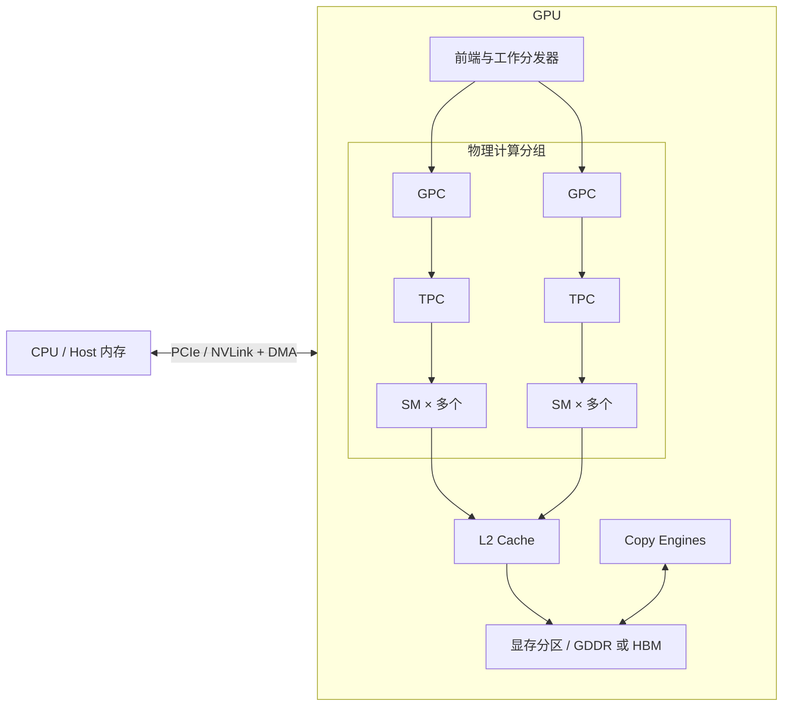
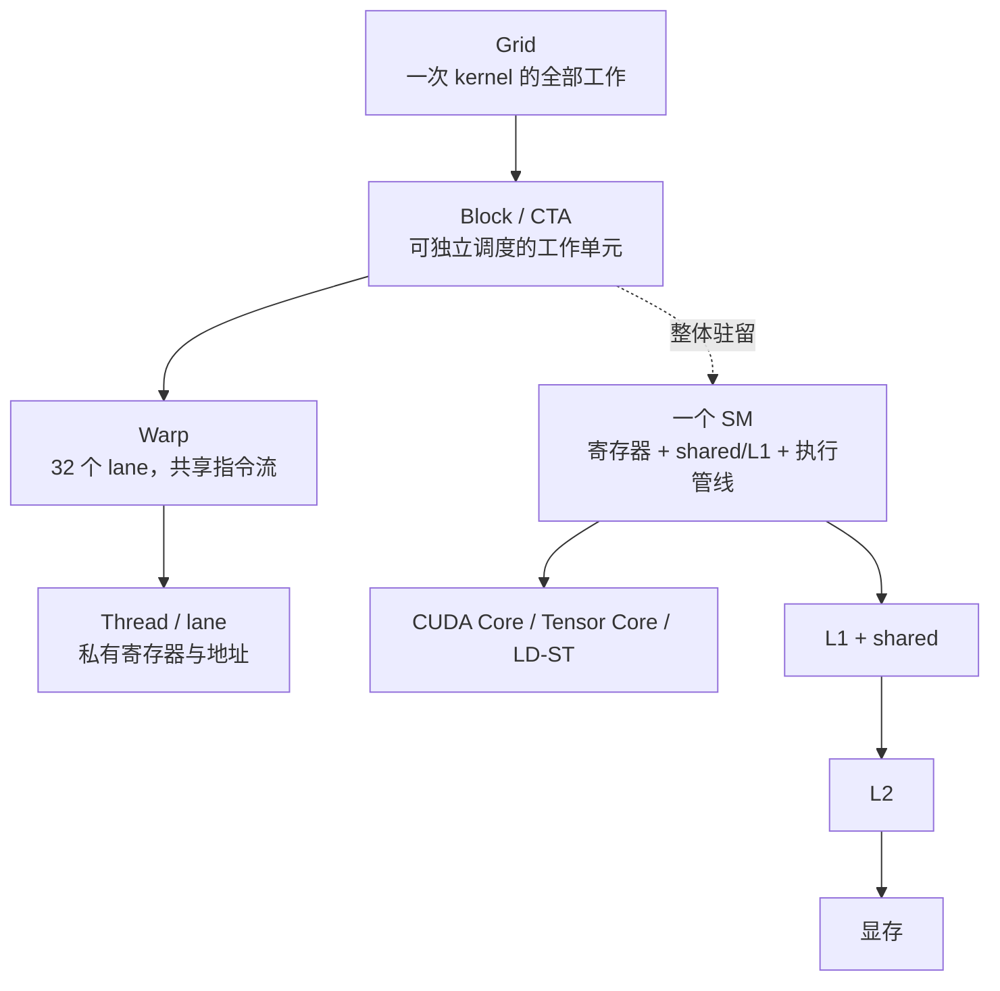
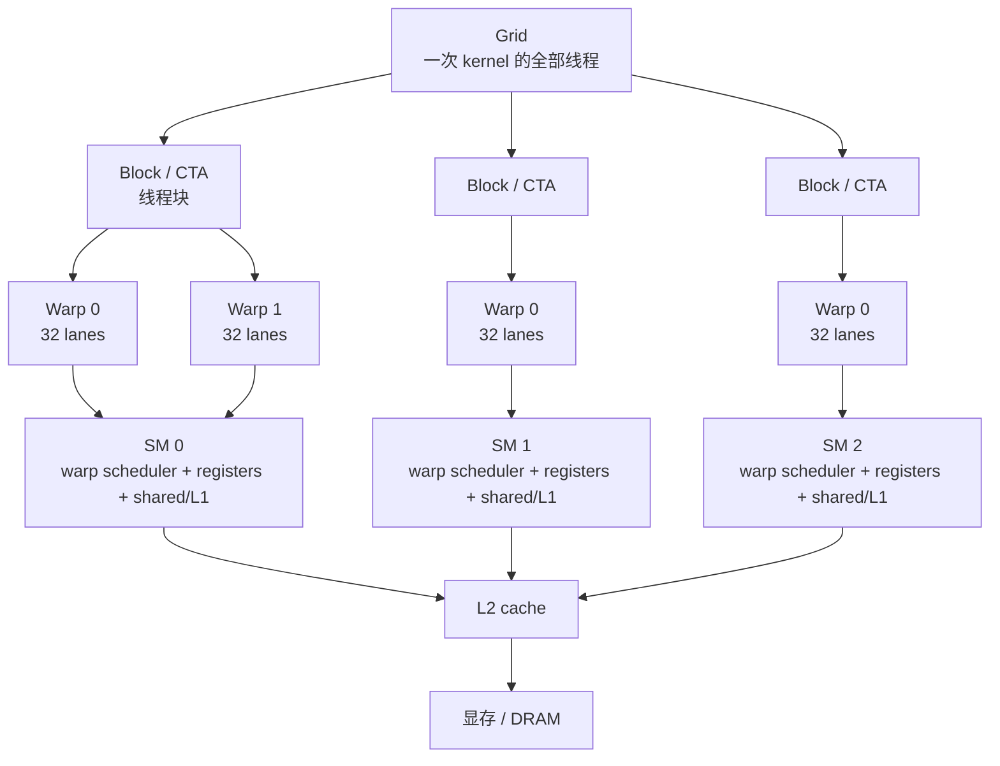
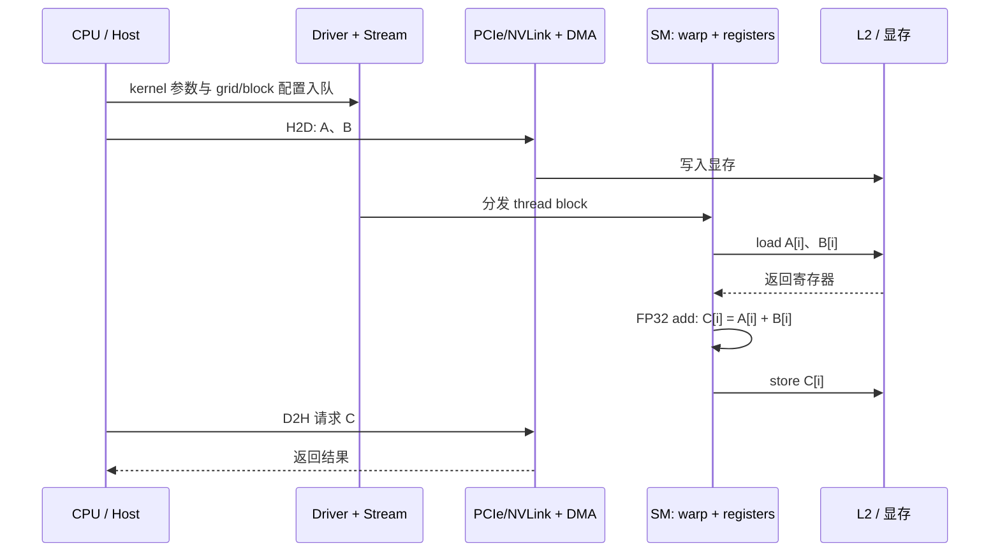

# GPU 硬件工作流程

> 本文回答一个核心问题：调用 CUDA kernel 之后，数据和指令在 GPU 内部经历了什么？

CUDA 是编程接口和执行模型；GPU 是真正执行指令、搬运数据、进行同步的硬件。不同 NVIDIA 架构的缓存大小、调度器数量和指令吞吐会变化，但下面的工作流程是稳定的抽象。

配套的交互式动画：[`gpu_workflow_animation.html`](gpu_workflow_animation.html)。打开后点击“播放”或“单步”，可以观察一次向量加法在各个硬件阶段之间移动。

地址链路配套章节：[`memory_address_pipeline.md`](memory_address_pipeline.md)；3D 版本：[`memory_address_3d.html`](memory_address_3d.html)。

## 0. 先看两张图

### 0.1 一张总地图：物理 GPU、CUDA 抽象和数据路径



这张图分成两种语言：GPC/TPC/SM 是硬件组织方式，Grid/Block/Warp 是 CUDA 的编程和调度抽象。GPC、TPC 的数量和内部组织会随 GPU 型号变化，CUDA 程序通常不直接控制它们；写 kernel 时最重要的是理解 block 如何获得一个 SM 的资源。



读代码时可以反向追踪：`<<<grid, block>>>` 定义 Grid 和 Block；`threadIdx/blockIdx` 定义线程如何找到数据；硬件把一个 Block 放到一个 SM，再拆成 Warp 发射指令；load/store 最终经过 L1/L2 和显存。

### 编程模型到硬件结构



关键点：block 会被整体放到一个 SM 上；warp 是调度和 SIMT 执行的基本单位；L2 和显存为全 GPU 共享的数据路径。

### 一次向量加法的通信与计算路径



静态图适合建立整体结构；需要观察“当前数据在哪个阶段”时，使用上面的交互式动画。

### 0.2 CUDA 代码如何映射到硬件

| CUDA 代码中的概念 | 硬件/运行时对应物 | 需要形成的判断 |
|---|---|---|
| Grid | 一次 kernel 的全部 block | Grid 要足够大，才能让多个 SM 持续有工作 |
| Block / CTA | 被整体分配到一个 SM 的资源包 | block 大小受线程、寄存器、shared memory 限制 |
| Warp | 32 lane 的 SIMT 调度单位 | 分支和访存都要从 warp 的角度看 |
| Thread / lane | 独立寄存器、谓词和地址 | 线程不是独立 CPU 核，执行仍受 warp 约束 |
| `__shared__` | SM 上的软件管理片上存储 | block 内复用数据，注意同步和 bank conflict |
| `cudaMemcpyAsync` | DMA 引擎和互连链路 | pinned memory、stream 和缓冲区生命周期决定能否重叠 |
| WMMA / MMA | Tensor Core 矩阵乘加管线 | tile、数据类型和供数速度决定利用率 |

## 1. 从 CPU 调用到 GPU 执行

```text
CPU 线程
  │  CUDA Runtime / Driver API
  ▼
驱动与命令队列
  │  kernel 参数、grid/block 配置、指针、stream 顺序
  ▼
GPU 前端 / 工作分发器
  │  把 thread block (CTA) 分配给有资源的 SM
  ▼
SM (Streaming Multiprocessor)
  │  block → warp(32线程) → 指令发射
  ├─ CUDA Core: FP32/INT 等标量指令
  ├─ Tensor Core: MMA 矩阵乘加
  ├─ LD/ST: 访存与地址计算
  └─ SFU: 特殊函数与部分转换
  ▼
寄存器 / L1 / shared / L2 / 显存
  │
  ▼
结果写回，stream 中的后续工作或 CPU 读取
```

kernel launch 通常是异步入队：CPU 把工作放入 stream 后可以继续运行。异步不代表没有顺序，**同一 stream 中的操作按顺序执行**；只有显式同步、事件依赖或 API 需要结果时，CPU 才会等待 GPU。

## 2. Block、warp 和 SM 如何配合

1. 一个 block（CTA）不会拆到多个 SM 上；它必须在一个 SM 上获得所需的寄存器、shared memory 和线程槽位。
2. 一个 block 被拆成若干 warp，每个 warp 有 32 个 lane。
3. warp scheduler 从“可运行”的 warp 中选择一个或多个发射指令。某个 warp 等待内存时，另一个 warp 可以占用发射机会。
4. 一个 SM 可以同时驻留多个 block。驻留数量由线程数、寄存器、shared memory、block 上限共同决定。
5. “同时驻留”不等于“所有线程每周期都执行”：执行资源和内存系统仍然需要排队。

因此，`<<<grid, block>>>` 只是描述工作规模；硬件会动态决定 block 先后顺序。不能依赖 block 的执行顺序，也不能用 block 内同步函数跨 block 同步。

## 3. 一条指令怎样被执行

以 `C[i] = A[i] + B[i]` 为例，一个 warp 的执行近似是：

```text
1. 每个 lane 计算自己的 i 和地址
2. LD/ST 单元合并 32 个 lane 的访问，形成尽可能少的内存事务
3. 数据到达寄存器后，由 FP32/INT 管线执行加法
4. 结果留在寄存器，随后由 ST 单元写回
```

GPU 使用 SIMT：同一 warp 通常共享一条指令流，但每个 lane 有自己的寄存器和谓词。遇到分支时，若 lane 走向不同，硬件会在不同路径之间切换执行，产生 warp divergence；不活跃 lane 在该路径上不产生有效工作。

Tensor Core 是另一条计算路径。一个 warp 或协作线程组把矩阵片段送入 MMA 指令，由专用矩阵单元完成多个乘加，再把累加片段写回寄存器。高性能 GEMM 之所以需要 tile、布局和流水，是为了持续给 Tensor Core 喂数据。

## 4. 数据通信路径

### 4.1 CPU 与 GPU

```text
CPU 内存 ── PCIe / NVLink ── GPU DMA 引擎 ── 显存
```

- 可分页 host memory 往往需要驱动先复制到 staging buffer；pinned memory 可以被 DMA 直接访问。
- `cudaMemcpyAsync` 只有在合适的 stream 和 pinned memory 条件下，才可能与 kernel 重叠。
- Unified Memory 隐藏了部分拷贝，但页迁移、缺页和预取仍然有成本。

### 4.2 GPU 内部

```text
thread register
      ↕
shared memory (block 可见) / L1 (硬件缓存)
      ↕
L2 cache (整个 GPU 共享)
      ↕
显存分区 / DRAM
```

- register 是线程私有，容量小但延迟低；用量过大可能 spill 到 local memory，而 local memory 实际位于显存层次。
- shared memory 是软件管理的片上存储，适合 block 内复用；bank conflict 会把一次访问拆成多个服务。
- L2 和显存用于跨 block 的数据交换，但访问延迟和带宽远高于片上存储。
- warp 访问连续地址时，内存系统可以合并事务；stride、随机访问和 AoS 布局可能浪费传输带宽。

### 4.3 GPU 与 GPU

多卡可以通过 PCIe、NVLink 或 P2P 访问。即使 P2P 可用，也要考虑链路带宽、拓扑和同步成本。NCCL 会根据拓扑选择 ring、tree 等通信算法；多 GPU 加速的关键通常是减少跨卡数据量，而不是单纯增加卡数。

## 5. 同步的硬件含义

| 范围 | CUDA 表达 | 硬件含义 |
|------|-----------|----------|
| lane / warp | `__shfl_sync`, `__ballot_sync` | 在 warp 内交换寄存器或活跃掩码 |
| block | `__syncthreads` | 等待 block 内线程到达，并保证相应内存可见 |
| stream | event、stream order | 让命令队列建立先后关系 |
| grid / 多 kernel | 分阶段 launch、cooperative groups | 通过结束一个 kernel 建立全局阶段边界 |
| CPU ↔ GPU | `cudaDeviceSynchronize`、事件 | 让 host 观察到设备完成或等待设备完成 |

同步解决“何时可以读”和“谁必须等待”，但不会自动解决写冲突。对同一个地址的并发写仍需要原子、分区、排序或算法改写。

## 6. 从硬件看一个 kernel 的完整时间线

以向量加法为例：

```text
H2D:       A/B 从 CPU 内存经 DMA 进入显存
Launch:    CPU 将 kernel 描述符放入 stream
Dispatch:  GPU 将 block 分发到多个 SM
Load:      warp 访问 A/B，经过 L2/显存返回寄存器
Compute:   FP32 管线执行加法
Store:     结果经 L2/显存写入 C
D2H:       CPU 需要结果时，DMA 把 C 复制回 host
```

这个 kernel 的算术强度很低，通常受显存带宽限制。把加法指令换成更复杂的表达式，可能仍不会变快；减少读写字节数、合并访问和融合相邻 kernel 更有价值。

以 tiled GEMM 为例：

```text
global/L2 -> shared tile A/B -> registers -> FP32/Tensor Core MMA -> global C
```

它通过 shared 和寄存器复用输入，提高算术强度，让计算管线更接近饱和。代价是 tile 边界处理、同步、shared bank conflict、寄存器压力和 occupancy 下降。

## 7. 计算方式和硬件单元

| 计算方式 | 执行单元 | 适合场景 | 关注点 |
|----------|----------|----------|--------|
| SIMT 标量/向量式线程 | CUDA Core + warp scheduler | 通用 kernel、分支较多的数值计算 | divergence、指令吞吐 |
| Warp-level primitive | warp 内寄存器交换与投票 | 归约、scan、过滤、匹配 | mask 正确性、活跃 lane |
| Tensor Core MMA | Tensor Core | GEMM、卷积、深度学习 | 数据类型、tile 布局、供数速度 |
| 异步内存拷贝 | copy engine / SM async path | 双缓冲、流水线、TMA | barrier、缓冲区生命周期 |
| DMA 传输 | copy engine | H2D、D2H、D2D | pinned memory、链路带宽、重叠 |

CUDA kernel 可以使用这些单元，但不会自动让所有单元同时工作。只有当数据准备、指令依赖和 stream 编排都允许时，计算与通信才会重叠。

## 8. 把硬件现象映射到代码症状

| 现象 | 常见硬件原因 | 优先检查 |
|------|--------------|----------|
| kernel 很短但端到端很慢 | launch、H2D/D2H 或同步占主导 | Nsight Systems 时间线、kernel 融合 |
| SM 利用率低、显存带宽也低 | 并发不足、依赖链长或 block 太少 | occupancy、grid 大小、同步 |
| 显存带宽低 | 非合并访问、重复搬运、随机访问 | Nsight Compute memory workload |
| occupancy 高但性能不高 | 计算/带宽瓶颈或指令效率低 | Roofline、eligible warps、pipe utilization |
| 分支多时速度突然下降 | warp divergence | 分支布局、数据重排、分桶 |
| shared memory 版本变慢 | tile 过大、bank conflict 或同步过多 | shared usage、bank conflict、tile 尺寸 |
| 多 GPU 扩展差 | 跨卡通信或同步占比高 | 链路拓扑、通信量、NCCL trace |

## 9. 推荐观测工具

```bash
nvidia-smi                         # 设备、显存、进程和基本利用率
nsys profile ./your_program       # CPU/GPU 时间线、stream、传输重叠
ncu ./your_program                # kernel 指标、访存、发射和管线利用率
compute-sanitizer ./your_program  # 越界、同步和数据竞争检查
```

先用 `hardware_basics/query_device.cu` 读取本机参数，再用 `bandwidth_test.cu` 测量实际链路。理论带宽、SM 数和 CUDA Core 数只是上限或资源描述，最终判断必须以测量结果为准。

## 10. 架构差异提醒

本文以 NVIDIA CUDA 的通用硬件模型和 RTX 4090 作为示例。不同 GPU 的 SM 资源、缓存、Tensor Core 精度、异步拷贝能力和调度细节会变化；不要把某一型号的数值硬编码成普遍规律。写优化代码时优先查询 `cudaDeviceProp`、查看目标架构的 Programming Guide，并在目标设备上 profile。
